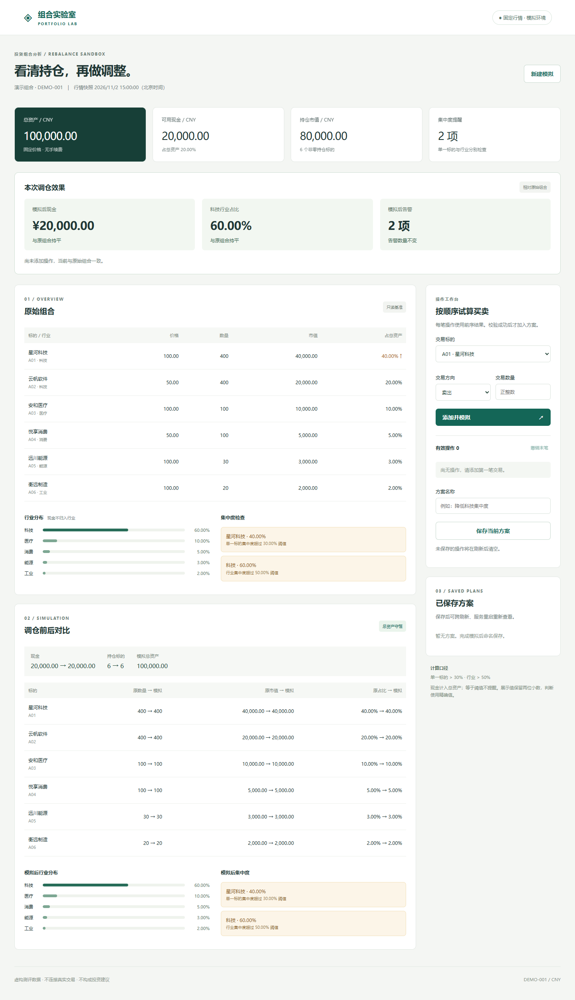
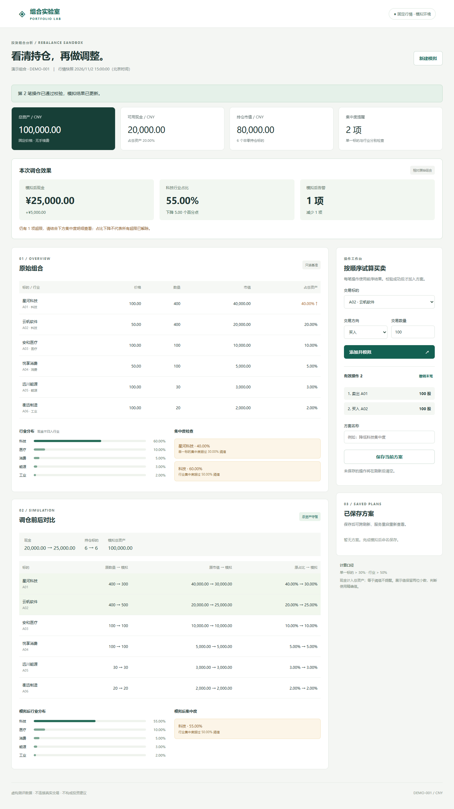
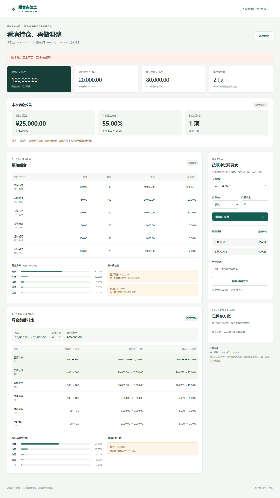
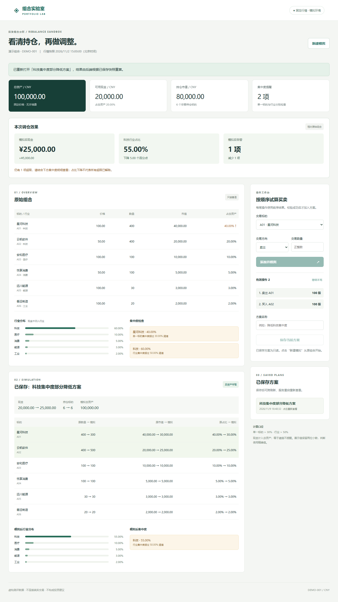
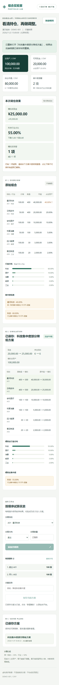
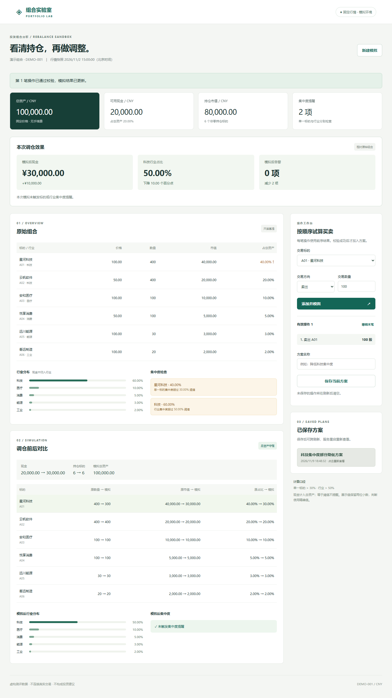
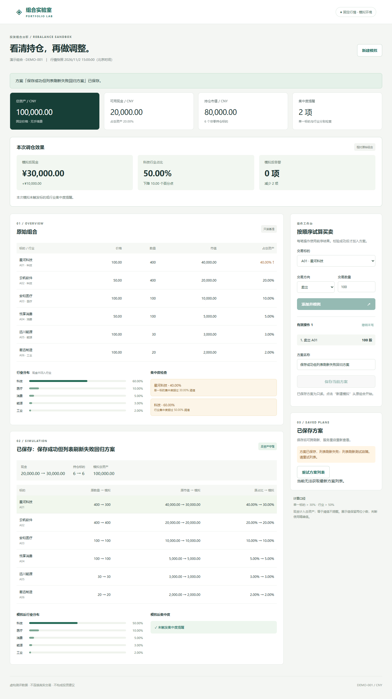

# 验证记录与运行截图

执行日期：2026-11-09，北京时间。自动验证由 Codex 驱动本地工具与真实浏览器，人工操作与本人确认另列；本轮列表故障修复尚未由候选人再次手动验收。

环境：Windows、Node.js v24.14.1、Playwright 1.65.0、本机 Microsoft Edge。后端使用内置 SQLite，浏览器视口 1440×1050 和 390×844；截图为完整页面。

## 实际命令与结果

| 检查 | 实际结果 | 证据 |
|---|---|---|
| `npm test` | 27 项通过，0 失败（耗时见原始日志） | docs/test-output.txt |
| `npm run test:ui` | 4 个端到端场景通过（含本轮2项列表故障回归，耗时见原始日志）；核心流程无 pageerror | docs/browser-output.txt |
| 页面截图检查 | 已检查核心流程截图及新增的草稿恢复、保存成功而列表失败截图；未见页面级溢出或内容重叠 | screenshots/ |

脚本见 tests/domain.test.js、tests/http.test.js、tests/ui.spec.js。浏览器测试每次建立独立 SQLite 数据库，避免上次结果污染空状态；不会修改正常运行数据库。

## 基准验收

| 用例 | 步骤与预期 | 实际结果 | 结论 |
|---|---|---|---|
| AC-01 | 读取初始组合：总资产 100000、现金 20000、A01 40%、科技 60%，恰好两条告警 | 全部匹配；页面显示 6 个非零标的 | 通过 |
| AC-02 | 卖出 A01 100：现金 30000，A01 市值 30000，A01 30%/科技 50%，无告警 | 全部匹配，总资产仍 100000 | 通过 |
| AC-03 | 接上一步买入 A02 100：现金 25000，A02 500 股/市值 25000，科技 55% | 全部匹配；仅科技行业告警；总资产不变 | 通过 |
| AC-04 | 分别从原组合买 A01 201、卖 A01 401、数量 0/-1/1.5 | 后端拒绝；原始快照序列化内容不变 | 通过 |
| AC-05 | 保存 AC-03；浏览器刷新重开；HTTP 测试停止进程、重新启动后 GET 方案 | 整个方案详情与保存响应一致；原始现金 20000、A01/A02 均 400 | 通过 |

## 扩展检查

- 买卖顺序：先卖 A01 100 再买 A01 250 可行，现金 5000；逆序买入现金不足，拒绝。
- 当前持仓约束：卖出 A01 100 后再卖 301 被拒绝，失败位置为第 2 笔；有效模拟重算仍一致。
- 浏览器状态不变：AC-03 后买入 A01 251，显示“第 3 笔：现金不足”，有效操作数保持 2，整个对比表 HTML 与提交前一致。
- 阈值精度：将现金改为 19999.99 后卖出 A01 100，A01 占比显示 30.00%，精确值略大于阈值，仍触发告警。
- 清仓/买回：清空所有持仓后现金 100000、持仓数 0、告警数 0；重新买入后标的数恢复。
- 输入防御：字符串数量、null、超安全整数、未知标的、未知方向、超过 100 笔均拒绝；零资产时占比为 0。
- HTTP：非法 JSON、缺少 operations、空白名称均 400；不存在方案 404；非法操作保存被拒绝且数据库方案数不增加。
- 窄屏：390px 视口下 documentElement.scrollWidth 不超过 innerWidth；表格内部允许滚动。
- 原始组合隔离：所有模拟使用局部快照副本，真实 HTTP 重启后再次检查初始持仓。

## 发现的问题与修正

### 本轮新增验证的独立依据

| 检查 | 独立预期/执行方式 | 实际结果 |
|---|---|---|
| 跨行业换仓守恒 | 卖 A01 123、买 A03 77、买 A04 31：现金=20000+12300−7700−1550=23050；持仓市值=27700+20000+17700+6550+3000+2000=76950 | 现金 23050、市值 76950、合计 100000；每个前缀也守恒，通过 |
| 用尽现金后卖出 | 买 A02 400 后现金 0，再卖 A03 100，现金 10000、持仓市值 90000 | 固定常量逐项匹配，通过 |
| 同标的往返 | 卖 A05 30 再买 30，现金 20000、市值 80000、六个数量均回到原值 | 逐项匹配，通过 |
| 阈值三点 | 卖 A01 100；初始现金为 20000.01/20000.00/19999.99，A01 与科技精确占比分别略低/等于/略高于 30%/50% | 两个阈值分别 false/false/true，即使展示都为 30.00%/50.00%，通过 |
| 小数金额 | 0.30 元按 0.10 元买入 3 股；另测分值超过 Number 安全整数的现金扣款 | 现金 0.00；90071992547409.93−0.10=90071992547409.83，通过 |
| 真实数据库写入失败 | 测试 SQLite 创建 BEFORE INSERT 触发器，RAISE(ABORT)；向真实保存接口提交合法方案 | 返回 500/INTERNAL_ERROR；SQL COUNT 与 API 列表长度均不变，通过；测试后移除触发器 |
| 接口故障不改变前端状态 | Playwright 分别注入模拟 500、模拟网络中断、保存 500，提交前后比较有效状态 DOM | 操作、对比表、现金、效果卡、未保存提示不变，按钮恢复可用，通过 |
| 效果摘要与剩余告警 | AC-03 预期 +5000、−5 个百分点、−1 条提醒，同时保留 1 项超限 | 后端对象断言和页面文本断言均通过 |
| 列表失败后重试保留草稿 | 初始组合成功、列表GET失败，卖A01 100形成1笔草稿；列表再失败后恢复，点击列表专用重试 | 操作数仍1、现金30000；对比表、效果卡、操作列表及保存状态不变；组合GET总次数仍1 |
| 保存成功而刷新列表失败 | 初始列表模拟为空，POST真实保存成功，只让后续列表GET返回500；失败重试一次后再恢复 | 成功提示保留、方案只读、不再显示暂无方案；直接API查询新记录已存在；重试只发GET，POST计数始终1，数据库记录不增加 |

数据库失败用例证明单条 INSERT 中止时没有新记录，不等同于断电或磁盘损坏恢复验证。浏览器故障通过请求拦截确定性注入，不代表真实服务当时发生故障；真实业务 400 与真实数据库 500 另有后端检查。

### 首版问题及处理记录

1. 首次 `npm test` 中 18 项计算用例通过，HTTP 用例因运行沙箱禁止本机连接（EACCES）失败。允许本机连接后复跑 19/19 通过，没有为通过测试弱化业务断言。
2. 首次安装浏览器测试依赖遇到沙箱 DNS 错误；在获准环境下载后完成。运行本身不依赖外部网络服务。
3. 第一轮浏览器用例在桌面业务流程通过后，窄屏页面宽度断言失败。修正网格子项 min-width 与标题换行后复跑通过。
4. 发现重复运行共用 UI 数据库会让“初始”截图包含上轮保存方案；改用每轮独立数据库，并新增空列表断言。最终日志和截图来自隔离后的运行。
5. 用户复现列表加载失败后的完整初始化重试会重置草稿。本轮分离组合初始化与列表重试，以故障仍在和故障恢复两次重试核验草稿不变。
6. 用户复现保存成功后列表GET失败会覆盖成功反馈。本轮局部处理列表失败，保持保存结果与成功提示，并以真实POST持久化、模拟GET失败验证不重复保存。
7. 两份重开人工截图哈希重复，上传原件也重复；明确标为同图复用，不能作为两次独立操作的截图。未补写或补拍未经执行的人工过程。

## 截图索引

### 01 初始组合

### 02 两笔连续调仓

### 03 错误反馈与状态保留

### 04 保存后刷新重开

### 05 窄屏附加检查

### 06 列表重试后保留草稿（自动回归）

### 07 保存成功而列表刷新失败（自动回归）

## 实际时间与未执行项

本轮优化自 2026-11-09 约 16:52 开始，至 17:00 完成代码、测试、文档及交付整理（阶段经过时间，非逐项工时统计）；这是 AI 工具执行窗口，不计为人工操作。需求输入包括用户对范围、三项技术决策、效果摘要、故障边界和单包交付结构的评阅。

后续列表恢复修复及截图哈希核对同日追加完成，由AI执行代码修改、自动回归和材料归档；4项浏览器场景的最新结果见日志。本轮未追加或虚构候选人人工耗时，约20分钟仍指此前本人确认的那次手动检查。

本次 AI 工具工作在 2026-11-09 完成；可核验的实现阶段起始时间为 16:26:54（PLAN.md 已写入后记录），最终核心/浏览器测试及截图复核完成于约 16:39。该阶段约 12 分钟，另有前置附件阅读及后续交付整理，未逐秒计量。候选人确认本次亲自检查约 20 分钟，涵盖启动、页面操作、手算、保存与重启恢复验证；这是本人估计的人工检查时长，不是全部开发工时。计划职责比人工∶AI=3∶7 不代表已测得工时比，也不将建议的 3–4 小时填为实际时长。

候选人已在逐步引导下完成下述页面操作并提交截图，随后明确确认已亲自手算、停止并重新启动服务后刷新重开方案，并确认人工检查约 20 分钟。其他未执行项包括其他操作系统/浏览器兼容性、多进程并发/性能、磁盘故障注入、保存幂等性测试。截图与自动测试不能代替人工掌握代码；最终提交和代码讲解由候选人负责。

## 候选人手动复核（按已提供证据更新）

候选人起初表示尚未执行，随后由本人操作 PowerShell 和浏览器，AI 逐步提供指引并核对本人上传截图。下面的人工记录来自这段实际操作，独立于前面的 AI 自动化日志。截图原件已复制到 `screenshots/manual/`；归档日期 2026-11-09，不将文件归档时间当作人工开始/结束时间。

**同图复用说明：** `09-reopened.png` 与 `11-recovered-reopened.png` 的 SHA-256 均为 `0F95ECD6DCB93E67E9F3D8FDD6A1F1FC91DD93C1EE16DFE668057AA240FBE163`，两份上传原件也相同。共13个PNG附件、12份不同图片。这一重开页面仅作为同一份结果图复用，不能证明两次独立操作；完整重启动作依据本人文字确认，自动进程重启验证另见 AC-05 日志。说明同时随截图放入 screenshots/manual/EVIDENCE.md。

| 人工检查 | 本人操作与实际结果 | 证据（screenshots/manual/） | 状态 |
|---|---|---|---|
| 环境和启动 | Windows PowerShell，Node v24.14.1；npm start 遭执行策略拦截，改用 npm.cmd start 后打印监听地址并成功打开页面 | 01-start-policy-error.png、02-start-success.png | 通过；启动问题已处理 |
| 初始页面 | 总资产100000、现金20000、A01占比40%、科技60%、2条提醒；原始A01/A02各400 | 03-initial-overview.png、04-initial-positions.png；本人后续确认已手算 | 通过 |
| 恰好等于阈值 | 第一笔卖出后，现金30000、科技50%、模拟提醒0；原始概览保持不变 | 05-threshold.png | 已截图字段通过；A01模拟数量未在该截图中展示 |
| 两笔连续操作 | 第二笔买入后，现金25000、科技55%、提醒1；页面提示第2笔通过 | 06-two-trades.png；本人后续确认已手算 | 已截图字段及手算复核通过 |
| 失败结果保留 | 第3笔提示“现金不足，无法完成买入”，现金仍25000、科技55%、告警1 | 07-rejected-buy.png | 已截图字段通过；有效列表笔数未单独截图，自动测试另有覆盖 |
| 命名保存 | 保存“科技集中度部分降低方案”，页面提示已保存，效果卡维持25000/55%/1项 | 08-saved.png | 通过 |
| 方案重开 | 在刷新重开步骤后提供已重新打开提示，效果卡恢复25000/55%/1项 | 09-reopened.png（与11同图） | 重开结果已展示；刷新动作依据指导流程，未录屏 |
| 服务中断后的恢复 | 操作期间出现 ERR_CONNECTION_REFUSED；本人明确确认已亲自停止服务、运行 npm.cmd start、刷新并重开相同方案，结果25000/55%/1项 | 10-connection-refused.png；11-recovered-reopened.png为09的同图复用，不构成独立重启截图；另有本人文字确认 | 本人确认通过；未单独提供完整终端及重启后独立截图 |
| 原始组合隔离 | 新建模拟后现金20000、科技60%、提醒2、A01/A02各400、有效操作0 | 12-reset-overview.png、13-reset-positions.png | 通过 |
| 空数量校验 | 最后一张截图出现“请填写此字段”，有效操作仍0 | 13-reset-positions.png | 界面必填校验已观察到 |
| 独立手算 | 本人明确确认已亲自手算，并授权按对应正确金额补齐记录；详细算式见下方 | 本人文字确认与页面截图 | 已确认完成 |
| 人工检查时长 | 本人确认约20分钟，包含启动、页面操作、手算、保存及重启验证；无逐项计时 | 本人文字确认“约20分钟” | 已记录；估计时长 |

实际发现的问题：PowerShell 禁止加载 npm.ps1，使用 npm.cmd start 恢复，无需修改执行策略；在重启步骤中出现连接被拒绝，按指引恢复访问（本人确认）。README 已补充处理方式。重开结果图为同图复用，人工重启结论依赖本人确认；自动重启测试单独作为程序验证，不与人工截图混算。

### 本人确认的手算复核

本人确认已亲自计算；下列算式与正确金额由 AI 根据已验收业务步骤整理，未冒充本人原始手写记录。

| 场景 | 独立复核算式 | 正确结果 |
|---|---|---|
| 原始总资产 | 40000+20000+10000+5000+3000+2000+20000 | 100,000.00元 |
| 原始科技占比 | (40000+20000)÷100000×100% | 60.00% |
| 卖出A01 100股后的现金 | 20000+100×100 | 30,000.00元 |
| 卖出后的科技占比 | (300×100+400×50)÷100000×100% | 50.00% |
| 再买A02 100股后的现金 | 30000−100×50 | 25,000.00元 |
| 再买入后的科技占比 | (300×100+500×50)÷100000×100% | 55.00% |

人工检查时间：约20分钟（本人确认的估计值）。核心人工复核记录已补齐；源码阅读、面试讲解准备和最终提交由候选人自行确认，不依据页面截图推断其已完成。

