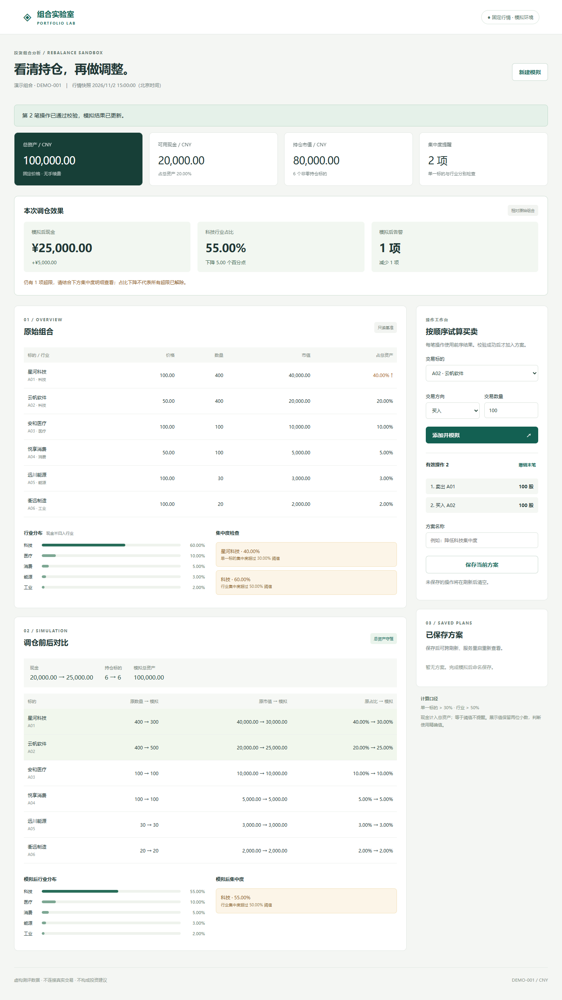

# 投资组合分析与调仓模拟 · 组合实验室

基于固定行情快照的全栈原型，支持组合概览、标的与行业集中度检查、顺序买卖模拟、调仓前后对比，以及方案命名保存和重开。单用户、单组合、CNY，无真实下单或实时行情。

## 三类交付材料

| 材料 | 入口 |
|---|---|
| 开工方案与设计文档 | [PLAN.md](01_开工方案与设计文档/PLAN.md) · [DESIGN.md](01_开工方案与设计文档/DESIGN.md) |
| 项目源码与运行说明 | [源码目录](02_项目源码与运行说明/) · [运行说明](02_项目源码与运行说明/README.md) |
| 验证记录与关键截图 | [VERIFY.md](03_验证记录与关键截图/VERIFY.md) · [截图目录](03_验证记录与关键截图/screenshots/) |

## 本地启动

使用 Node.js 24（实测 v24.14.1）。下载仓库或克隆后进入源码目录：

```sh
git clone https://github.com/tyy200203/portfolio-rebalancing-lab.git
cd portfolio-rebalancing-lab
cd "02_项目源码与运行说明"
npm start
```

浏览器访问 [http://127.0.0.1:3000](http://127.0.0.1:3000/)。无第三方运行依赖；首次启动自动创建本地 SQLite 文件，无需额外安装数据库。Windows PowerShell 若拦截 npm.ps1，使用 `npm.cmd start`。运行期间保持终端打开。

后端使用 Node.js 内置 HTTP、SQLite 和 BigInt 整数分计算；前端使用原生 HTML/CSS/JavaScript。金额、阈值与操作约束均由后端计算。

## 核心验收

1. 初始总资产100,000元、现金20,000元、A01占比40%、科技60%，触发2项提醒。
2. 卖出A01 100股：现金30,000元，A01占比30%、科技50%，提醒解除。
3. 再买入A02 100股：现金25,000元、A02共500股、科技55%，保留1项行业超限。
4. 操作失败保留此前有效结果；方案保存后支持刷新及服务重启后重新打开，原始组合不变。
5. 方案列表失败可单独重试；保存成功而列表刷新失败时，保留保存成功状态，不重复创建方案。



## 验证结果

在源码目录执行：

```sh
npm ci
npm test
npm run test:ui
```

27项后端/HTTP检查和4项浏览器场景通过，包含金额守恒、阈值边界、错误状态保留、真实进程重启及列表故障恢复。浏览器测试使用本机 Microsoft Edge；替代环境配置见源码目录 README。

候选人已亲自完成核心流程检查、手算与重启验证，人工检查约20分钟。自动测试执行、人工确认和截图证据分别记录；同图复用说明见 [人工截图证据说明](03_验证记录与关键截图/screenshots/manual/EVIDENCE.md)。

未实现登录、实时行情、策略预测、多用户权限及方案编辑/删除；已知限制和AI协作记录见 DESIGN.md。数据均为虚构测评数据，不构成投资建议。

仓库不包含依赖安装目录、日常数据库、密钥、个人简历或招聘方原始任务PDF。PLAN.md为实现前保留版本；本次仓库首次上传为已完成项目的统一归档。
